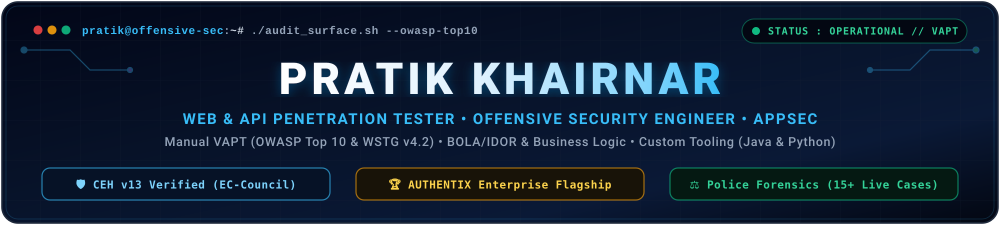

<p align="center">
  
</p>

<p align="center">
  
</p>

<p align="center">
  <a href="https://pratikkhairnarsec.web.app/"></a>
  <a href="https://linkedin.com/in/pratik-khairnar-sec/"></a>
  <a href="mailto:pratik.khairnar.sec@gmail.com"></a>
  <a href="https://github.com/pratik-khairnar-sec"></a>
</p>

<p align="center">
  <b><a href="#-executive-profile--security-leadership">Executive Dossier</a></b> •
  <b><a href="#-operational-experience--case-work">Police Forensics</a></b> •
  <b><a href="#-verified-certifications--education">Credentials</a></b> •
  <b><a href="#-flagship-offensive-architecture-authentix-enterprise">AUTHENTIX Flagship</a></b> •
  <b><a href="#-complete-offensive-security-arsenal">Tool Arsenal</a></b> •
  <b><a href="#-technical-competency-matrix">Skills Matrix</a></b> •
  <b><a href="#-direct-reach--contact">Contact</a></b>
</p>

---

## 🎯 Executive Profile & Security Leadership

> [!NOTE]
> ### 🛡️ Professional Dossier
> - **Specialization:** **Web & REST API Penetration Testing (VAPT)**, **Offensive Security Tool Engineering**, and **Digital Forensics**.
> - **Accredited Credentials:** **Certified Ethical Hacker (CEH v13)** (EC-Council Exam ID: `ECC8042517936` • ANSI/ISO/IEC 17024 Accredited) • **Cisco Certified Network Associate (CCNA)** (Cisco Networking Academy).
> - **Academic Foundation:** Bachelor of Technology (**B.Tech**) in Computer Science & Engineering (**Cyber Security & Forensics**), Sandip University, Nashik (2023 — 2027) • **CGPA: 7.42 / 10**.
> - **Law Enforcement Operations:** Cyber Crime & Digital Forensics Intern, **Cyber Police Station, Nashik Police Commissionerate** (15+ live cybercrime and financial fraud investigations; ISO/IEC 27037 chain-of-custody).
> - **Tool Architecture:** Offensive Security Tool Architect (Java 17/21 & Python 3) • Author of Flagship **AUTHENTIX Enterprise v2.1.0**, **BlindStrike v7.0.0**, **Reflectra v7.0.0**, and **ReconForge v3**.
> - **Standards & Methodologies:** **OWASP Top 10 (2021)**, **OWASP API Security Top 10 (2023)**, **OWASP WSTG v4.2**, **OWASP ASVS v4.0**, **NIST SP 800-115**, **CVSS v3.1** Defensible Scoring.
> - **Location & Mobility:** **Pune, Maharashtra, India** (Open to Worldwide Relocation & Remote Engagements).
> - **Direct Reach:** ✉️ **[pratik.khairnar.sec@gmail.com](mailto:pratik.khairnar.sec@gmail.com)** • 📞 **[+91 87999 81052](tel:+918799981052)** • 🌐 **[pratikkhairnarsec.web.app](https://pratikkhairnarsec.web.app/)**

```
┌─────────────────────────────────┐  ┌─────────────────────────────────┐  ┌─────────────────────────────────┐
│     ⚖️ Law Enforcement Casework │  │     🏆 Offensive Architecture   │  │    📜 Verified Credentials      │
│  • 15+ Live Police Cases        │  │  • AUTHENTIX Enterprise (v2.1)  │  │  • CEH v13 (EC-Council Accred)  │
│  • ISO/IEC 27037 Chain-of-Cust  │  │  • 34 Invariants · 16 ATO Chains│  │  • Exam ID: ECC8042517936       │
│  • CDR / IPDR & Wireshark PCAP  │  │  • Java 17/21 Offensive Engine  │  │  • CCNA & B.Tech Cyber Security │
└─────────────────────────────────┘  └─────────────────────────────────┘  └─────────────────────────────────┘
```

I am an **Offensive Security Engineer**, **EC-Council Certified Ethical Hacker (CEH v13)**, and **Security Tool Architect**. My tradecraft bridges the gap between deep **manual penetration testing** (specializing in authorization logic flaws like BOLA/IDOR, OAuth/JWT bypasses, and time-based injection) and **custom offensive systems engineering**.

Rather than relying purely on off-the-shelf automated scanners that produce noise and false positives, I architect purpose-built offensive software: native **Java 17/21 Burp Suite Montoya extensions** with deterministic state-machine invariant tracking, statistical **Interquartile Range (IQR) blind SQL injection engines**, and context-aware headless browser DOM XSS validation engines. Grounded in live forensic investigations with the **Cyber Police Station, Nashik Police Commissionerate**, I evaluate security postures with an attacker's ingenuity and evidentiary precision.

---

## 💼 Operational Experience & Case Work

### 🔍 Cyber Crime & Digital Forensics Intern — Cyber Police Station, Nashik Police Commissionerate
*Jan 2026 – May 2026 | Nashik, Maharashtra, India*
- **Live Cybercrime Investigations:** Investigated **15+ live cybercrime, unauthorized server intrusion, identity theft, and multi-lakh financial fraud cases** alongside senior cyber cell officers, strictly enforcing **Chain of Custody** standards aligned to **ISO/IEC 27037**.
- **Packet-Level Traffic Reconstruction:** Conducted deep packet inspection and network stream analysis using **Wireshark** to reconstruct malicious HTTP/TCP sessions, uncover command-and-control (C2) communication patterns, and isolate malware payload delivery vectors.
- **Telecom & Digital Evidence Triage:** Triaged suspicious Android APK packages, correlated **Call Detail Records (CDR)** and **IP Detail Records (IPDR)** telecom intelligence with banking transaction logs, identifying fraudulent payment gateways and compromised endpoints to assist officers in formal charge sheet preparation.

### 🛡️ Offensive Security Tool Architect & Independent Security Researcher
*2023 – Present | Pune, India*
- **Burp Montoya API Engineering:** Designed and maintained **AUTHENTIX Enterprise**, automating multi-tenant authorization testing (BOLA/IDOR) across role and tenant boundaries using deterministic finite-state automata in **Java 17/21**.
- **Statistical Vulnerability Detection:** Engineered **BlindStrike v7.0.0**, eliminating latency noise on unstable networks by applying Interquartile Range (IQR) statistical distribution filtering for time-based blind SQL injection extraction.
- **Context-Aware DOM XSS Engine:** Developed **Reflectra v7.0.0**, weaponizing 2,600+ context-prioritized payloads evaluated through headless Chrome dialog interception with zero false positives.
- **Reconnaissance Operating System:** Built **ReconForge v3**, a zero-install client-side bug bounty recon engine comprising 30 structured phases and 52,630+ curated dorks.

---

## 📜 Verified Certifications & Education

| Credential / Degree | Issuing Organization | Verification Details / Focus Areas |
|---|---|---|
| **Certified Ethical Hacker (CEH v13)** | **EC-Council** | Verified Credential • Exam ID: `ECC8042517936` • ANSI/ISO/IEC 17024 Accredited • Web/API Exploitation, Network Defense, Threat Intelligence & Countermeasures |
| **Cisco Certified Network Associate (CCNA)** | **Cisco Networking Academy** | Enterprise Routing, Switching, TCP/IP Mechanics, IPv4/IPv6 Subnetting, VLAN Segmentation & Packet Inspection |
| **B.Tech CSE (Cyber Security & Forensics)** | **Sandip University, Nashik** | 2023 — 2027 • **CGPA: 7.42 / 10** • Core: Application Security, Cryptography, Secure Software Development, Digital Forensics |

> [!TIP]
> **Credential Verification:** Official credential scans and EC-Council badge can be verified directly at **[pratikkhairnarsec.web.app/#certifications](https://pratikkhairnarsec.web.app/#certifications)**.

---

## 🏆 Flagship Offensive Architecture: AUTHENTIX Enterprise

> **Autonomous Multi-Tenant Authorization, BOLA/IDOR & Secret Analysis Suite for Burp Suite**  
> *(Engineered on PortSwigger Montoya API • Java 17/21 • Deterministic State Machine)*

<p align="center">
  <a href="https://pratik-khairnar-sec.github.io/authentix-enterprise/" target="_blank">
    
  </a>
</p>

```
       [ Burp Suite HTTP Proxy / Repeater / Scanner / Intruder ]
                                   │
                                   ▼
                       [ TrafficInterpreter.java ]
                 (Actor Attribution & Flow Classification)
                                   │
         ┌─────────────────────────┴─────────────────────────┐
         ▼                                                   ▼
[ FlowGraphEngine.java ]                        [ TokenLifecycleTracker.java ]
(Per-Actor State Machine)                     (SHA-256 Hashes, Shannon Entropy,
                                                Single-Use, Expiration, JWT)
         │                                                   │
         └─────────────────────────┬─────────────────────────┘
                                   ▼
         ┌─────────────────────────┴─────────────────────────┐
         ▼                                                   ▼
[ InvariantEngine.java ]                        [ FileAnalyzerEngine.java ]
 (34 Formal Invariants)                          (30+ Secret / Logic Rules)
         │                                                   │
         └─────────────────────────┬─────────────────────────┘
                                   ▼
                      [ AttackPathCorrelator.java ]
                (Chains Findings into 16 Compound ATO Graphs)
                                   │
         ┌─────────────────────────┴─────────────────────────┐
         ▼                                                   ▼
[ Burp Suite Modern UI Tabs ]                       [ Telegram Alerts Push ]
  - Findings & Cross-Actor Matrix                     - Zero UI Latency Async
  - Attack Chains Graph Studio                        - Kali cURL PoC Generator
  - 3-Way Differential IDOR Engine                    - Soft-200 Filter
```

### ⚡ Architectural Highlights:
- 🎯 **3-Way Differential IDOR / BOLA Engine:** Automates cross-actor state substitution across 3 concurrent user sessions with intelligent Soft-200 and customized error suppression (OWASP API1:2023, API5:2023).
- 🛡️ **34 Formal State-Machine Invariants:** Deterministic verification of authorization states including OTP replay flaws, session fixation, token Shannon entropy, race conditions, and structural JWT integrity (`alg:none`, key confusion).
- 🔬 **30+ Secret & Token Detection Rules:** Real-time stream inspection targeting leaked JWT signing keys, AWS, GCP, Azure, OpenAI, Claude, Stripe, GitHub, Firebase, and SendGrid credentials.
- ⛓️ **16 Compound Attack Chain Rules:** Automatically synthesizes discrete low/medium severity vulnerabilities into actionable Account Takeover (ATO) kill-chain graphs.
- 🌐 **Documentation & Live Architecture:** 👉 [https://pratik-khairnar-sec.github.io/authentix-enterprise/](https://pratik-khairnar-sec.github.io/authentix-enterprise/)

---

## 🛡️ Complete Offensive Security Arsenal

| Suite / Tool | Core Architecture & Technology | Version | Category | Live Demo Sandbox | GitHub Repository |
|---|---|---|---|---|---|
| **AUTHENTIX Enterprise** | Native Burp Suite Montoya API: 34 Invariants, 30+ Secret Rules, 16 ATO Chains (Java 17/21) | `v2.1.0` | 🏆 Flagship | [🌐 Live Sandbox](https://pratik-khairnar-sec.github.io/authentix-enterprise/) | [`authentix-enterprise`](https://github.com/pratik-khairnar-sec/authentix-enterprise) |
| **Cybersecurity Showcase** | Official Interactive Cybersecurity Portfolio & VAPT Engineer Showcase | `Production` | 🌐 Portfolio | [🌐 Live Showcase](https://pratikkhairnarsec.web.app/) | [`portfolio`](https://github.com/pratik-khairnar-sec/portfolio) |
| **BlindStrike** | Latency-calibrated Time & Boolean Blind SQLi Framework with Interquartile Range (IQR) noise filtering | `v7.0.0` | 🛡️ AppSec | [🌐 Live Demo](https://pratik-khairnar-sec.github.io/BlindStrike/) | [`BlindStrike`](https://github.com/pratik-khairnar-sec/BlindStrike) |
| **Reflectra** | Context-aware DOM XSS scanner with Headless Chrome verification & zero false positives | `v7.0.0` | 🛡️ AppSec | [🌐 Live Demo](https://pratik-khairnar-sec.github.io/Reflectra/) | [`Reflectra`](https://github.com/pratik-khairnar-sec/Reflectra) |
| **ReconForge** | Master Bug Bounty & VAPT Reconnaissance Operating System (30 Phases & 52,630+ Curated Dorks) | `v3.0.0` | ⚡ OSINT | [🌐 Live Demo](https://pratik-khairnar-sec.github.io/ReconForge/) | [`ReconForge`](https://github.com/pratik-khairnar-sec/ReconForge) |
| **CORSair** | Cross-Origin Resource Sharing security analyzer with Shannon entropy token leak detection | `v3.0.0` | 🛡️ AppSec | [🌐 Live Demo](https://pratik-khairnar-sec.github.io/CORSair/) | [`CORSair`](https://github.com/pratik-khairnar-sec/CORSair) |
| **WaybackLens** | High-performance Wayback Machine CDX Recon & Triage Chrome Extension (Manifest V3) | `v1.0.0` | 🔎 OSINT | [🌐 Live Demo](https://pratik-khairnar-sec.github.io/wayback-lens/) | [`wayback-lens`](https://github.com/pratik-khairnar-sec/wayback-lens) |
| **EndpointFinder** | Autonomous Chrome Extension for deep client-side JavaScript endpoint & parameter extraction | `v1.0.0` | 🔎 Recon | [🌐 Live Demo](https://pratik-khairnar-sec.github.io/endpoint-finder-extension/) | [`endpoint-finder-extension`](https://github.com/pratik-khairnar-sec/endpoint-finder-extension) |

---

## 🛠️ Technical Competency Matrix

### 1. Application Security, Penetration Testing & Standards
| Category | Technical Competencies & Industry Standards |
|---|---|
| **Standards & Benchmarks** | **OWASP Top 10 (2021)**, **OWASP API Security Top 10 (2023)**, **OWASP WSTG v4.2**, **OWASP ASVS v4.0**, **NIST SP 800-115**, **PTES**, **CVSS v3.1** |
| **Access Control & Auth** | Broken Object Level Authorization (**BOLA / IDOR**), Broken Function Level Authorization (**BFLA**), OAuth 2.0 Flaws, JWT Token Tampering (`alg:none`, key confusion), Horizontal & Vertical Privilege Escalation |
| **Injection & Dataflow** | Time-Based Blind SQLi (IQR-filtered), Boolean Blind SQLi, Source-to-Sink DOM XSS, Reflected/Stored XSS, Server-Side Request Forgery (**SSRF**), Command Injection, XXE |
| **Web Transport & Architecture** | Cross-Origin Resource Sharing (**CORS Misconfiguration - ACAO/ACAC**), Content Security Policy (**CSP Bypass**), HTTP Request Smuggling, Host Header Injection |
| **Forensics & Investigations** | Chain of Custody (**ISO/IEC 27037**), Wireshark PCAP Packet Dissection, Android APK Forensics, CDR / IPDR Telecom Correlation, IOC Extraction |

### 2. Languages, Scripting & Engineering
<p align="left">
  
  
  
  
  
  
</p>

### 3. Security Arsenal & Laboratory Tooling
<p align="left">
  
  
  
  
  
  
  
  
  
</p>

---

<p align="center">
  <b>Pratik Sanjay Khairnar</b><br>
  <sub>⚡ Certified Ethical Hacker (CEH v13) • Offensive Security Engineer • Security Tool Architect ⚡</sub><br>
  <sub>🌐 <a href="https://pratikkhairnarsec.web.app/">pratikkhairnarsec.web.app</a> • ✉️ <a href="mailto:pratik.khairnar.sec@gmail.com">pratik.khairnar.sec@gmail.com</a> • 💼 <a href="https://linkedin.com/in/pratik-khairnar-sec/">LinkedIn Profile</a> • 📞 <a href="tel:+918799981052">+91 87999 81052</a></sub><br>
  <sub>📍 Pune, Maharashtra, India (Open to Worldwide Relocation)</sub>
</p>