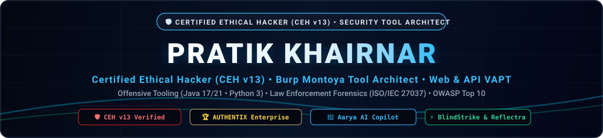
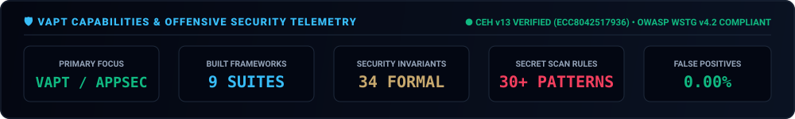

<p align="center">
  
</p>

<p align="center">
  
</p>

<p align="center">
  <a href="mailto:pratik.khairnar.sec@gmail.com"></a>
  <a href="https://pratikkhairnarsec.web.app/"></a>
  <a href="https://linkedin.com/in/pratik-khairnar-sec/"></a>
  <a href="mailto:pratik.khairnar.sec@gmail.com"></a>
</p>

<p align="center">
  <a href="https://linkedin.com/in/pratik-khairnar-sec/"></a>
  <a href="https://pratikkhairnarsec.web.app/"></a>
  <a href="https://x.com/PratikSec"></a>
  <a href="https://pratik-khairnar-sec.medium.com/"></a>
  <a href="https://t.me/pratik_khairnar_sec"></a>
  <a href="https://www.instagram.com/pratik.khairnar.sec/"></a>
  <a href="https://www.youtube.com/@pratik-khairnar-sec"></a>
  <a href="https://discord.com/users/1531910259080167494"></a>
</p>

---

## 🎯 Executive Profile & Recruiter ATS Snapshot

> [!IMPORTANT]
> ### 💼 Candidate Overview — Actively Seeking Roles (Immediate Joining)
> - **Target Positions:** **VAPT Engineer**, **Web Application Penetration Tester**, **Application Security (AppSec) Engineer**, **Associate Security Consultant**, **Cyber Security Analyst / VAPT Consultant**.
> - **Availability:** **Immediate Joining Available** • Open to Full-Time, On-Site, Hybrid, and Remote Roles (**Pune / Mumbai / Bengaluru / Delhi-NCR / Remote**).
> - **Verified Certifications:** Certified Ethical Hacker (**CEH v13** | EC-Council Exam ID: `ECC8042517936`) • Cisco Certified Network Associate (**CCNA**).
> - **Education:** Bachelor of Technology (**B.Tech**) in Computer Science & Engineering (**Cyber Security & Forensics**), Sandip University, Nashik (2023 — 2027) • **CGPA: 7.42 / 10**.
> - **Operational Experience:** Junior Penetration Tester (**GROOTT Services**) • Cyber Crime & Digital Forensics Intern (**Cyber Police Station, Nashik Police Commissionerate**).
> - **Tooling Architecture:** Native **Burp Suite Montoya API** Extension Developer (Java 17/21) • Author of **AUTHENTIX Enterprise v2.1.0**, **Reflectra v7.0.0**, and **BlindStrike v7.0.0**.
> - **Methodology Compliance:** **OWASP Top 10 (2021)**, **OWASP API Security Top 10 (2023)**, **OWASP WSTG v4.2**, **OWASP ASVS v4.0**, **NIST SP 800-115**, **CVSS v3.1** Severity Scoring.
> - **Interactive Showcase:** 🌐 **[https://pratikkhairnarsec.web.app/](https://pratikkhairnarsec.web.app/)**
> - **Direct Reach:** ✉️ **[pratik.khairnar.sec@gmail.com](mailto:pratik.khairnar.sec@gmail.com)** • 📞 **[+91 87999 81052](tel:+918799981052)**

I am an **Offensive Security Engineer**, **Certified Ethical Hacker (CEH v13)**, and **Security Tool Developer** from India. My technical foundation blends **rigorous manual web application penetration testing**, **REST API authorization assessments**, and **offensive tooling engineering**.

Having executed commercial vulnerability assessments across multi-tenant applications at **GROOTT Services** and assisted in **15+ live cybercrime and financial fraud investigations** with the **Cyber Police Station, Nashik Police Commissionerate**, I approach security from both attacker and defensive forensics viewpoints. I prioritize zero-false-positive validation, strict latency noise filtering (IQR), reproducible Proof-of-Concepts (PoCs), and defensible **CVSS v3.1** remediation advisories that developers can implement immediately.

---

## 💼 Professional Experience & Operations

### 🛡️ Junior Penetration Tester — GROOTT Services
*Jun 2025 – Oct 2025 | Remote / Hybrid*
- **Manual Web VAPT & API Audits:** Executed manual Vulnerability Assessment and Penetration Testing across production client web applications and RESTful APIs benchmarked against **OWASP Top 10 (2021)** and **OWASP WSTG v4.2** guidelines.
- **High-Severity Vulnerability Discovery:** Discovered and exploited high-impact vulnerabilities including Broken Object Level Authorization (**BOLA / IDOR**), Broken Function Level Authorization (**BFLA**), OAuth 2.0 authentication bypasses, JWT token signature tampering, and Boolean Blind SQL injection.
- **Reporting & Risk Triage:** Formulated comprehensive technical and executive-level VAPT documentation featuring **CVSS v3.1** scoring, defensible Proof-of-Concepts (PoCs), curl reproduction scripts, and developer remediation roadmaps.
- **Remediation Verification & Closure Retesting:** Collaborated directly with software development teams to conduct post-fix **closure retesting**, validating that vulnerabilities were remediated at root-cause before deployment to staging/production.

### 🔍 Cyber Crime & Digital Forensics Intern — Cyber Police Station, Nashik Police Commissionerate
*Jan 2026 – May 2026 | Nashik, MH, India*
- **Live Cybercrime Case Investigation:** Investigated **15+ live cybercrime, financial fraud, unauthorized data access, and identity theft cases** in direct coordination with law enforcement officers, strictly adhering to legal **Chain of Custody** protocols.
- **Packet-Level Network Analysis:** Conducted deep packet inspection and network traffic analysis using **Wireshark** to reconstruct malicious network sessions, extract malware payload delivery vectors, and trace compromised communication endpoints.
- **Telecom & Digital Evidence Triage:** Analyzed suspicious Android APK packages, correlated **Call Detail Records (CDR)** and **IP Detail Records (IPDR)** telecom intelligence, and extracted high-fidelity **Indicators of Compromise (IOCs)** to support formal legal evidentiary proceedings.

---

## 📜 Certifications & Academic Credentials

| Credential / Degree | Issuing Organization | Verification Details / Specialization |
|---|---|---|
| **Certified Ethical Hacker (CEH v13)** | **EC-Council** | Verified Credential • Exam ID: `ECC8042517936` • Ethical Hacking, Attack Vectors & Defensive Countermeasures |
| **Cisco Certified Network Associate (CCNA)** | **Cisco Networking Academy** | Enterprise Routing, Switching, Network Security Protocols, IP Addressing & Packet Analysis |
| **B.Tech CSE (Cyber Security & Forensics)** | **Sandip University, Nashik** | 2023 — 2027 (Final Year) • **CGPA: 7.42 / 10** • Core: Application Security, SSDLC, Cryptography, Digital Forensics |

---

## 🛠️ Core Technical Competencies (ATS Keyword Matrix)

### 1. Application Security, Penetration Testing & Standards
| Domain | Core ATS Competencies & Methodologies |
|---|---|
| **Testing Standards & Frameworks** | **OWASP Top 10 (2021)**, **OWASP API Security Top 10 (2023)**, **OWASP WSTG v4.2** (Web Security Testing Guide), **OWASP ASVS v4.0**, **NIST SP 800-115**, **PTES** (Penetration Testing Execution Standard), **SANS Top 25** |
| **Testing Methodologies** | Manual Web VAPT, Black-box Testing, Gray-box Testing, White-box Testing, Dynamic Application Security Testing (**DAST**), Static Application Security Testing (**SAST**), Secure Code Review, Threat Modeling, Secure SDLC (**SSDLC**) |
| **Access Control & Authorization** | Broken Object Level Authorization (**BOLA / IDOR - API1:2023**), Broken Function Level Authorization (**BFLA - API5:2023**), Broken Access Control (**A01:2021**), Horizontal & Vertical Privilege Escalation, Multi-Tenant Isolation Flaws |
| **Authentication & Session State** | OAuth 2.0 Flow Bypasses, JWT Signature Tampering & None Algorithm, Session Fixation, Session Hijacking, OTP Replay, Weak Password Reset Logic, Token Entropy Analysis |
| **Injection & Data Handling** | Time-Based Blind SQL Injection, Boolean Blind SQL Injection, Error-Based SQLi, Source-to-Sink DOM XSS, Reflected XSS, Stored XSS, Command Injection, Server-Side Request Forgery (**SSRF**), XML External Entity (**XXE**) |
| **Web Infrastructure & Transport** | Cross-Origin Resource Sharing (**CORS Misconfiguration - ACAO/ACAC**), Content Security Policy (**CSP Bypass**), HTTP Request Smuggling, Host Header Injection, SSL/TLS Cipher Auditing |
| **Reporting & Vulnerability Management** | **CVSS v3.1** Base Scoring, Defensible PoC Formulation, Zero False-Positive Triage, Remediation Verification, Closure Retesting, Developer-Ready Remediation Advisories |

### 2. Security Tools & Testing Arsenal
<p align="left">
  
  
  
  
  
  
  
  
  
</p>

### 3. Languages, Scripting & Extension Engineering
<p align="left">
  
  
  
  
  
  
</p>

---

## 🏆 Flagship Enterprise Suite: AUTHENTIX v2.1.0

> **Next-Generation Authentication, IDOR/BOLA & Secret Analysis Extension for Burp Suite**  
> *(Engineered on PortSwigger Montoya API • Java 17/21 • Deterministic Finite-State Automaton)*

<p align="center">
  <a href="https://pratik-khairnar-sec.github.io/authentix-enterprise/" target="_blank">
    
  </a>
</p>

```
       [ Burp Suite HTTP Proxy / Repeater / Scanner / Intruder ]
                                   │
                                   ▼
                       [ TrafficInterpreter.java ]
                 (Actor Attribution & Flow Classification)
                                   │
         ┌─────────────────────────┴─────────────────────────┐
         ▼                                                   ▼
[ FlowGraphEngine.java ]                        [ TokenLifecycleTracker.java ]
(Per-Actor State Machine)                     (SHA-256 Hashes, Shannon Entropy,
                                                Single-Use, Expiration, JWT)
         │                                                   │
         └─────────────────────────┬─────────────────────────┘
                                   ▼
         ┌─────────────────────────┴─────────────────────────┐
         ▼                                                   ▼
[ InvariantEngine.java ]                        [ FileAnalyzerEngine.java ]
 (27 Formal Invariants)                          (28 Secret / Logic Rules)
         │                                                   │
         └─────────────────────────┬─────────────────────────┘
                                   ▼
                      [ AttackPathCorrelator.java ]
                (Chains Findings into 12 Compound ATO Graphs)
                                   │
         ┌─────────────────────────┴─────────────────────────┐
         ▼                                                   ▼
[ Burp Suite Modern UI Tabs ]                       [ Telegram Alerts Push ]
  - Findings & Cross-Actor Matrix                     - Zero UI Latency Async
  - Attack Chains Graph Studio                        - Kali cURL PoC Generator
```

### ⚡ Technical Capabilities of AUTHENTIX:
- 🎯 **Cross-Actor IDOR & BOLA Matrix:** Automatically parses sequential and UUID identifiers across multiple authenticated user sessions to identify horizontal and vertical authorization bypasses.
- 🛡️ **27 Formal State-Machine Invariants:** Deterministic verification of authentication states including OTP replay flaws, session fixation, token Shannon entropy, and structural JWT integrity.
- 🔬 **28 Secret & Token Detection Rules:** Real-time stream inspection targeting leaked JWT signing keys, AWS, GCP, Azure, OpenAI, Claude, Stripe, GitHub, Firebase, and SendGrid credentials.
- ⛓️ **12 Compound Attack Chain Rules:** Automatically synthesizes discrete low/medium severity vulnerabilities into actionable Account Takeover (ATO) kill-chain graphs.
- 📱 **Real-Time Mobile Push Dispatcher:** Delivers instant alerts with terminal-ready Kali cURL reproduction commands directly to Telegram bots.
- 🌐 **Enterprise Documentation & Reports:** 👉 [https://pratik-khairnar-sec.github.io/authentix-enterprise/](https://pratik-khairnar-sec.github.io/authentix-enterprise/)

---

## 🛡️ Production Security Arsenal & Open-Source Projects

<!-- START_PORTFOLIO -->
| Repository | Architecture & Core Capability | Version | Category | Interactive Portal | Source Code |
|---|---|---|---|---|---|
| **AUTHENTIX Enterprise** | Burp Suite Montoya Suite: 27 Invariants, 28 Secret Rules, 12 ATO Chains | `v2.1.0` | 🏆 Flagship | [🌐 Live Demo](https://pratik-khairnar-sec.github.io/authentix-enterprise/) | [`authentix-enterprise`](https://github.com/pratik-khairnar-sec/authentix-enterprise) |
| **Cybersecurity Showcase** | Official Interactive Cybersecurity Portfolio & VAPT Engineer Showcase | `Live` | 🌐 Portfolio | [🌐 Live Site](https://pratikkhairnarsec.web.app/) | [`portfolio`](https://github.com/pratik-khairnar-sec/portfolio) |
| **Reflectra** | Context-aware XSS scanner with Headless Chrome PoC verification & DOM-sink triage | `v7.0.0` | 🛡️ AppSec | [🌐 Live Demo](https://pratik-khairnar-sec.github.io/Reflectra/) | [`Reflectra`](https://github.com/pratik-khairnar-sec/Reflectra) |
| **BlindStrike** | Time-Based & Boolean Blind SQLi engine with Interquartile Range (IQR) noise calibration | `v7.0.0` | 🛡️ AppSec | [🌐 Live Demo](https://pratik-khairnar-sec.github.io/BlindStrike/) | [`BlindStrike`](https://github.com/pratik-khairnar-sec/BlindStrike) |
| **ReconForge** | Master Bug Bounty & VAPT reconnaissance workspace with 30 Phases & 52,600+ Dorks | `v3.0.0` | ⚡ Framework | [🌐 Live Demo](https://pratik-khairnar-sec.github.io/ReconForge/) | [`ReconForge`](https://github.com/pratik-khairnar-sec/ReconForge) |
| **CORSair** | Cross-Origin Resource Sharing (CORS) misconfiguration auditor & automated PoC generator | `v3.0.0` | 🛡️ AppSec | [🌐 Live Demo](https://pratik-khairnar-sec.github.io/CORSair/) | [`CORSair`](https://github.com/pratik-khairnar-sec/CORSair) |
| **WaybackLens** | High-performance Wayback Machine CDX Recon & Triage Chrome Extension (Manifest V3) | `v1.0.0` | 🔎 OSINT | [🌐 Live Demo](https://pratik-khairnar-sec.github.io/wayback-lens/) | [`wayback-lens`](https://github.com/pratik-khairnar-sec/wayback-lens) |
| **EndpointFinder** | Client-side Chrome Extension for deep JavaScript AST endpoint & parameter extraction | `v1.0.0` | 🔎 Recon | [🌐 Live Demo](https://pratik-khairnar-sec.github.io/endpoint-finder-extension/) | [`endpoint-finder-extension`](https://github.com/pratik-khairnar-sec/endpoint-finder-extension) |
<!-- END_PORTFOLIO -->

---

## 📝 Research Publications & Technical Whitepapers

<p align="center">
  <a href="https://pratik-khairnar-sec.medium.com/" target="_blank">
    
  </a>
  <a href="https://x.com/PratikSec" target="_blank">
    
  </a>
  <a href="https://discord.com/users/1531910259080167494" target="_blank">
    
  </a>
</p>

### 🌟 Featured Architectural Whitepaper:
> ### 📖 [ReconForge v3: Automating 30 Phases of Bug Bounty Reconnaissance, Zero-Install, 52,600+ Search Queries](https://pratik-khairnar-sec.medium.com/reconforge-v3-automating-33-phases-of-bug-bounty-reconnaissance-zero-install-13-600-search-7c0e353a709b)
> 
> An architectural deep dive into designing a 100% client-side, zero-install reconnaissance operating system. Covers recursive query expansion across 30 offensive testing phases, client-side state engines, dynamic tokenization, and multi-dork attack surface analysis.
> 
> 🔗 **[Read Full Article on Medium](https://pratik-khairnar-sec.medium.com/reconforge-v3-automating-33-phases-of-bug-bounty-reconnaissance-zero-install-13-600-search-7c0e353a709b)** • 🧵 **[Technical Breakdown on X (@PratikSec)](https://x.com/PratikSec/status/2108584870293451190)**

---

## 📈 GitHub Telemetry & Real-Time Activity

<p align="center">
  
</p>

<p align="center">
  
  
</p>

<p align="center">
  
</p>

---

## 🔍 Comprehensive ATS Index & Keyword Taxonomy

<details>
<summary><b>📋 Click to Expand Comprehensive ATS & Recruiter Keyword Index</b></summary>
<br>

**Job Roles & Positions:**  
VAPT Engineer, Web Application Penetration Tester, Application Security Engineer, AppSec Analyst, Junior Penetration Tester, Associate Security Consultant, Information Security Analyst, Cyber Security Researcher, Ethical Hacker, Offensive Security Engineer, SOC Analyst Level 1, Junior Cyber Defense Analyst.

**Testing Methodologies & Standards:**  
OWASP Top 10 (2021), OWASP API Security Top 10 (2023), OWASP WSTG v4.2, OWASP ASVS v4.0, NIST SP 800-115, PTES (Penetration Testing Execution Standard), SANS Top 25 Most Dangerous Software Errors, Common Weakness Enumeration (CWE), Common Vulnerability Scoring System (CVSS v3.1), Dynamic Application Security Testing (DAST), Static Application Security Testing (SAST), Secure SDLC (SSDLC), Threat Modeling, Vulnerability Management.

**Vulnerabilities & Attack Vectors:**  
Broken Object Level Authorization (BOLA), Insecure Direct Object References (IDOR), Broken Function Level Authorization (BFLA), Broken Access Control, Privilege Escalation (Horizontal & Vertical), Multi-Tenant Isolation Flaws, Time-Based Blind SQL Injection, Boolean Blind SQL Injection, SQLi, Cross-Site Scripting (XSS), Reflected XSS, Stored XSS, DOM-based XSS, Source-to-Sink Analysis, Content Security Policy (CSP) Bypass, Server-Side Request Forgery (SSRF), Cross-Origin Resource Sharing (CORS) Misconfiguration, Access-Control-Allow-Origin (ACAO), Access-Control-Allow-Credentials (ACAC), OAuth 2.0 State Flaws, JWT Token Security, JWT None Algorithm, Weak Secret Keys, Session Fixation, Session Hijacking, OTP Replay Attacks, Business Logic Vulnerabilities, Rate Limiting Bypasses, Host Header Injection, Information Disclosure.

**Security Tools & Arsenal:**  
Burp Suite Professional, Burp Suite Community, Burp Suite Montoya API, PortSwigger Web Security Academy, Postman, OWASP ZAP, Nmap, Wireshark, SQLMap, Kali Linux, Ubuntu Linux, Docker, Git, GitHub Actions, ffuf, Gobuster, Dirsearch, Metasploit Framework, Headless Chrome, Puppeteer, Playwright.

**Programming, Scripting & Frameworks:**  
Python 3 (Requests, Regex, BeautifulSoup, Scapy, PoC Automation), Java 17, Java 21, OpenJDK, Bash, Shell Scripting, JavaScript (ES6+), Chrome Extension Manifest V3, HTML5, CSS3, SQL, JSON, RESTful APIs, GraphQL.

**Digital Forensics & Law Enforcement:**  
Chain of Custody, Call Detail Record (CDR) Analysis, IP Detail Record (IPDR) Analysis, Packet Capture (PCAP) Dissection, Android APK Reverse Engineering, Indicators of Compromise (IOC) Identification, Cybercrime Fraud Investigation.

**Certifications & Education:**  
Certified Ethical Hacker (CEH v13 - EC-Council), Cisco Certified Network Associate (CCNA), B.Tech Computer Science and Engineering (Cyber Security & Digital Forensics).

</details>

---

## 🛡️ Responsible Disclosure & Ethical Statement

> [!NOTE]
> All software repositories, tools, proof-of-concept scripts, and technical research published under this profile are developed strictly for **educational security research**, **authorized penetration testing**, and **defensive vulnerability assessments**.
> 
> Security testing against digital targets without prior written authorization from the system owner is strictly illegal. As a security professional and Certified Ethical Hacker, I strictly adhere to responsible disclosure guidelines and ethical security standards.

---

<p align="center">
  <b>Pratik Sanjay Khairnar</b><br>
  <sub>⚡ Certified Ethical Hacker (CEH v13) • Web VAPT Engineer • Offensive Security Tooling Developer ⚡</sub><br>
  <sub>🌐 <a href="https://pratikkhairnarsec.web.app/">pratikkhairnarsec.web.app</a> • ✉️ <a href="mailto:pratik.khairnar.sec@gmail.com">pratik.khairnar.sec@gmail.com</a> • 💼 <a href="https://linkedin.com/in/pratik-khairnar-sec/">LinkedIn Profile</a> • 📞 <a href="tel:+918799981052">+91 87999 81052</a></sub>
</p>
